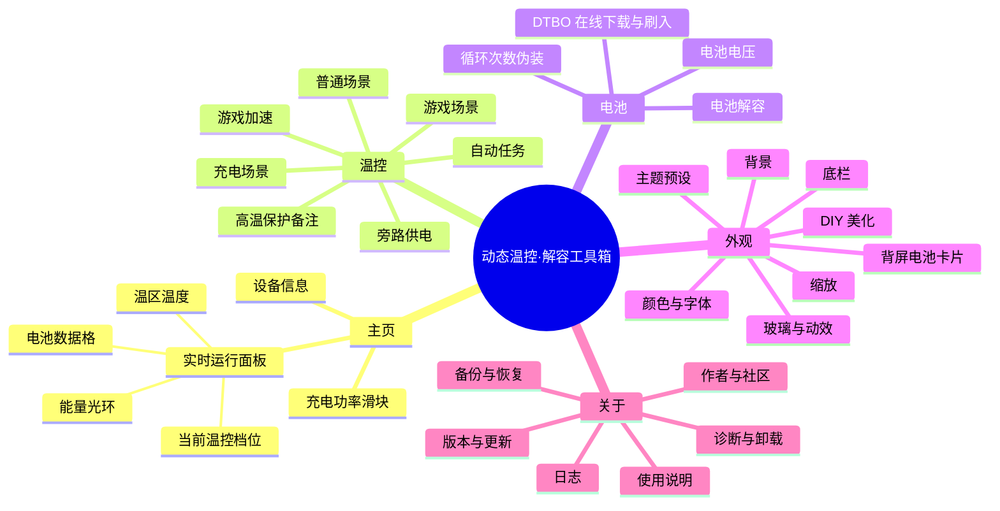

# 动态温控·解容工具箱 功能思维导图与大纲

> 来源：`v2.1.0-beta14` 模块页面  
> 修改依据：[功能思维导图与大纲.md](D:/桌面/功能思维导图与大纲.md)  
> 说明：本文按你修改后的功能范围整理，只描述功能，不研究实现方式。

## 一、功能思维导图

## 二、页面大纲

### 1. 主页

主页是整个工具箱的运行监控入口。

#### 1.1 实时运行面板

| 功能项 | 功能说明 |
|---|---|
| 能量光环 | 显示实时功率，光环内液面高度表示电量 |
| 当前档位胶囊 | 显示当前生效的温控档位，如系统默认、无限制、一档至五档、旁路 |
| 面板收起/展开 | 可以整体收起实时运行面板，减少页面长度 |
| 电池数据格 | 展示电量、状态、充电协议、电压、电流、温度、循环次数、伪装次数 |
| 容量与寿命数据格 | 展示设计容量、满充容量、剩余容量、健康度、电池寿命 SOH |
| 温区温度 | 展示设备温区温度，电池温度优先显示 |

#### 1.2 充电功率

| 功能项 | 功能说明 |
|---|---|
| 充电功率滑块 | 从 5W 到全速选择充电功率 |
| 范围端点 | 左端 5W，右端全速 |
| 当前档位描述 | 显示当前充电功率状态或说明 |

#### 1.3 设备信息

| 功能项 | 功能说明 |
|---|---|
| 模块版本 | 显示当前模块版本 |
| 当前日期 | 显示设备当前日期 |
| 设备型号 | 显示手机型号 |
| 系统版本 | 显示系统版本 |
| 运行环境 | 显示当前界面运行环境识别结果 |

### 2. 温控

温控页负责不同使用场景下的温度策略。

#### 2.1 温控档位

可选档位：

| 档位 | 含义 |
|---|---|
| 系统默认 | 不做额外温控调整 |
| 无限制 | 不设置温度阈值 |
| 一档 | 较宽松限制，约 45~50℃ |
| 二档 | 约 40~45℃ |
| 三档 | 约 35~40℃ |
| 四档 | 约 31~35.5℃ |
| 五档 | 约 26~30.5℃ |

#### 2.2 普通场景温控

| 功能项 | 功能说明 |
|---|---|
| 默认温控档位 | 设置非充电、非游戏时的温控档位 |
| 兜底场景 | 其他场景未生效时使用普通场景 |

#### 2.3 充电场景

| 功能项 | 功能说明 |
|---|---|
| 充电场景开关 | 决定是否启用充电时的独立温控 |
| 亮屏充电档位 | 使用系统默认、无限制、一档至五档 |
| 息屏充电档位 | 使用系统默认、无限制、一档至五档 |
| 定时切换 | 设置开始小时、结束小时和指定档位 |

#### 2.4 游戏场景

| 功能项 | 功能说明 |
|---|---|
| 游戏场景开关 | 决定是否启用游戏识别 |
| 游戏温控档位 | 使用系统默认、无限制、一档至五档 |
| 锁定刷新率 | 设置游戏内刷新率，0 表示关闭 |
| 游戏应用列表 | 管理哪些应用按游戏场景处理 |
| 手动添加包名 | 通过包名添加游戏应用 |
| 从已安装应用选择 | 从设备应用列表中选择游戏 |
| 删除游戏 | 从游戏列表中移除应用 |

#### 2.5 游戏加速

| 功能项 | 功能说明 |
|---|---|
| HyperOS 游戏三倍速 | 开启后立即生效，并设置开机后自动执行 |
| 状态说明 | 显示当前开启或关闭状态 |

#### 2.6 自动任务

| 功能项 | 功能说明 |
|---|---|
| 定时充电计划 | 在指定时间段自动切换功率 |
| 开始时间 | 设置小时，范围 0~23 |
| 结束时间 | 设置小时，范围 0~23，支持跨夜 |
| 目标功率 | 使用滑块从 5W 到全速选择 |
| 手动让路规则 | 时间段内手动改过功率档后不再接管 |

#### 2.7 温控页高温保护备注

| 功能项 | 功能说明 |
|---|---|
| 高温保护说明 | 高温自动降充电功率与温度回落恢复默认开启 |
| 展示方式 | 仅作为温控页备注展示，不提供独立功能卡片 |

#### 2.8 旁路供电

| 功能项 | 功能说明 |
|---|---|
| 手动旁路 | 立即开启或关闭旁路供电 |
| 游戏时旁路供电 | 检测到游戏应用时启用旁路 |
| 温度开启阈值 | 设置温度达到多少摄氏度开启 |
| 温度关闭阈值 | 设置温度回落到多少摄氏度关闭 |
| 电量开启阈值 | 设置电量达到多少后开启旁路 |

### 3. 电池

电池页负责电池解容、DTBO 和电压管理。

#### 3.1 电池解容

| 功能项 | 功能说明 |
|---|---|
| 电池解容开关 | 开启电池解容，防低电量锁容 |
| 公版 PPS 解锁 | 提升第三方充电头的功率兼容性 |
| 云控屏蔽 | 拦截云端配置下发与巡检隔离 |
| 自适应功率爬坡 APL | 在全速档下按硬件上限动态上探 |

#### 3.2 DTBO

| 功能项 | 功能说明 |
|---|---|
| DTBO 刷入 | 刷入当前机型对应的 DTBO |
| 在线下载 | 在线下载当前手机对应的 DTBO |
| 状态显示 | 显示当前识别或刷入状态，显示刷入流程和确认流程 |
| 确认流程 | 刷入前确认，重启生效 |

#### 3.3 循环次数伪装

| 功能项 | 功能说明 |
|---|---|
| 当前伪装值 | 显示当前循环伪装次数 |
| 目标次数输入 | 输入想要显示的循环次数 |
| 应用伪装 | 让循环次数显示为设定值 |
| 清除伪装 | 恢复真实循环次数 |

#### 3.4 电池电压

| 功能项 | 功能说明 |
|---|---|
| 满电电压 | 设置 4300~4700 mV 范围内的满电电压 |
| 当前满电电压 | 显示已设置值或未设置 |
| 强制覆盖原厂上限 | 当目标值超过原厂上限时开启 |
| 关机电压 | 设置 2800~3500 mV 范围内的关机电压 |
| 当前关机电压 | 显示已设置值或未设置 |
| 应用电压 | 同时提交满电电压和关机电压 |
| 关闭电压 | 关闭并还原电压设置 |
| 风险提示 | 显示电池老化、硬件保护、生效条件和还原说明 |

### 4. 显示外观

外观页负责界面主题、材质、布局和个性化显示。

#### 4.1 主题

| 功能项 | 功能说明 |
|---|---|
| 极光浅色 | 浅色主题 |
| 全息流体 | 浅色主题 |
| 暗黑霓虹 | 深色主题 |
| 幻彩极光 | 深色主题 |
| 赛博霓虹 | 深色主题 |
| 熔岩鎏金 | 深色主题 |
| 冰川琉璃 | 浅色主题，默认液态玻璃 |
| 月海流银 | 深色主题，默认液态玻璃 |
| 全局恢复默认 | 恢复外观，但保留已存方案、刷新间隔和模块运行设置 |

#### 4.2 背屏电池卡片

| 功能项 | 功能说明 |
|---|---|
| 背屏卡片开关 | 在支持背屏的机型上投放电池卡片 |
| 卡片预览 | 按 976×596 比例显示背屏效果 |
| 四角数据项 | 可从 14 项中最多选择 4 项显示 |
| 可选字段 | 温度、电量、电压、电流、功率、状态、设计容量、满充容量、健康度、循环、伪装、协议、剩余容量、电池寿命 |
| 字号大小 | 小、中、大三档 |
| 挖孔避让 | 左侧挖孔区域不显示内容 |
| 异常回滚 | 开启后自检异常时自动停止 |

#### 4.3 玻璃与动效

| 功能项 | 功能说明 |
|---|---|
| 液态玻璃 | 使用高透玻璃质感 |
| 流畅模式 | 减少模糊、波浪和动效，提升流畅度 |
| 页面切换曲线 | 选择页面切换动效 |
| 淡入淡出强度 | 调整页面过渡强度 |
| 标题过渡模糊度 | 调整标题切换时的模糊程度 |

#### 4.4 缩放

| 功能项 | 功能说明 |
|---|---|
| 界面字体缩放 | 调整全局字体大小 |
| 常规卡片缩放 | 调整卡片整体大小 |
| 卡片圆角调节 | 调整卡片圆角 |

#### 4.5 质感

| 功能项 | 功能说明 |
|---|---|
| 玻璃卡片质感 | 开启或关闭半透明卡片 |
| 卡片透明度 | 调整卡片透明程度 |
| 悬浮底栏 | 将底栏切换为悬浮样式 |
| 隐藏底栏文字 | 只显示底栏图标 |
| 跟随卡片透明度 | 底栏透明度跟随卡片设置 |
| 底栏背景扭曲 | 开启底栏波浪扭曲效果 |
| 底栏背景模糊 | 控制底栏模糊强度 |
| 底栏宽度 | 调整底栏宽度 |
| 底栏高度 | 调整底栏高度 |
| 底栏透明度 | 调整底栏透明程度 |
| 底栏纯色背景度 | 混入纯色背景 |
| 底栏纯色背景颜色 | 选择底栏纯色 |
| 底栏背景模糊度 | 调整模糊数值 |

#### 4.6 背景

| 功能项 | 功能说明 |
|---|---|
| 自定义背景开关 | 开启或关闭背景壁纸 |
| 卡片毛玻璃 | 切换卡片毛玻璃质感 |
| 青柠凝露 | 内置壁纸预设 |
| 冰蓝凝露 | 内置壁纸预设 |
| 紫晶凝露 | 内置壁纸预设 |
| 琥珀凝露 | 内置壁纸预设 |
| 默认壁纸 | 恢复默认背景 |
| 选择本地图片 | 使用相册或文件中的图片 |
| 清除壁纸 | 清空自定义背景 |
| 背景模糊度 | 调整壁纸模糊程度 |

#### 4.7 颜色与字体

| 功能项 | 功能说明 |
|---|---|
| 分类字体颜色 | 调整分类标题颜色 |
| 分类字体透明度 | 调整分类标题透明度 |
| 卡片字体颜色 | 调整卡片标题颜色 |
| 卡片字体透明度 | 调整卡片标题透明度 |
| 说明字体颜色 | 调整说明文字颜色 |
| 说明字体透明度 | 调整说明文字透明度 |
| 字体颜色恢复默认 | 重置字体颜色 |
| 全局字体族 | 更换界面字体 |
| 字体样式恢复默认 | 重置字体 |
| 分割线颜色 | 自定义分割线颜色 |
| 分割线透明度 | 自定义分割线透明度 |
| 分割线恢复默认 | 重置分割线 |
| 显示卡片分类 | 控制分类标题显隐 |
| 显示卡片注释 | 控制说明文字显隐 |
| 顶部标题注释 | 控制顶部副标题显隐 |

#### 4.8 DIY 美化

| 功能项 | 功能说明 |
|---|---|
| 背景光斑数量 | 可选关闭、1 个、2 个、3 个 |
| 背景光斑样式 | 调整大小、模糊、透明度、漂移和速度 |
| 背景噪点 | 控制噪点显示和强度 |
| 光斑颜色 | 自定义背景光斑颜色 |
| 能量光环样式 | 调整环宽、轨道、发光、数字尺寸等 |
| 液面波浪 | 调整主页光环中的液面效果 |
| 液面高度模式 | 按电量、固定高度或常亮满格 |
| 进度弧发光颜色 | 自定义光环发光颜色 |
| 卡片与文字尺寸 | 调整间距、内边距等 |
| 底栏尺寸 | 调整圆角、图标尺寸等 |
| 主页数据格列数 | 自动、2 列、3 列 |
| 主页字段显隐 | 控制 13 个主页数据格字段 |
| 面板默认状态 | 记住上次、默认展开、默认收起 |
| 卡片显隐 | 控制各页面卡片是否显示 |
| 恢复默认布局 | 重置主页和卡片布局 |
| 外观方案 | 保存、切换、导入、导出外观方案 |

### 5. 关于

关于页负责版本、帮助、诊断、备份和卸载。

#### 5.1 作者与声明

| 功能项 | 功能说明 |
|---|---|
| 小米热炸了 | 整合维护者入口 |
| AxiaojiuY | 动态温控作者入口 |
| 听夜风1337 | 电池解容工具箱作者入口 |
| 二改声明 | 说明当前包的整合来源和维护者 |

#### 5.2 社区入口

| 功能项 | 功能说明 |
|---|---|
| 动态温控 QQ 群 | 打开动态温控交流群 |
| 电池解容 QQ 群 | 打开电池解容交流群 |

#### 5.3 设备与模块信息

| 功能项 | 功能说明 |
|---|---|
| 设备型号 | 显示当前手机型号 |
| 系统版本 | 显示当前系统版本 |
| 运行环境 | 显示当前通道识别结果 |

#### 5.4 版本与更新

| 功能项 | 功能说明 |
|---|---|
| 更新日志 | 查看历次更新内容 |
| 检查更新 | 检查最新版本 |
| 当前版本 | 显示当前模块版本 |
| 更新来源 | GitHub、作者酷安、Telegram |

#### 5.5 帮助

| 功能项 | 功能说明 |
|---|---|
| 使用说明 | 按主页、温控、电池、外观、关于分组说明功能 |
| 特别鸣谢 | 显示帮助过项目的贡献者 |
| 注意事项 | 提示高温、包名、刷新率、旁路等风险 |
| 温控档位说明 | 解释各档位温度范围 |
| 场景功能说明 | 解释普通、充电、游戏场景 |
| 场景判断优先级 | 说明游戏、充电、普通场景的先后顺序 |

#### 5.6 日志与诊断

| 功能项 | 功能说明 |
|---|---|
| 查看日志文件 | 查看运行日志 |
| 诊断与日志打包 | 打包配置和日志用于反馈 |
| 卸载模块 | 卸载并还原系统配置，需要二次确认 |

#### 5.7 备份与恢复

| 功能项 | 功能说明 |
|---|---|
| 设置统计 | 显示已保存设置项数和数据大小 |
| 同步模块设置 | 手动备份模块运行设置 |
| 保存路径 | 设置备份输出目录 |
| 复制到剪贴板 | 复制外观设置 JSON |
| 保存到指定路径 | 把备份写入指定目录 |
| 浏览器下载 | 通过浏览器下载备份 |
| 完整备份 | 打包 UI 设置、config 和 profiles |
| 粘贴 JSON 恢复 | 从粘贴内容恢复设置 |
| 从文件恢复 | 选择 JSON 备份文件恢复 |
| 完整恢复 | 覆盖恢复模块配置和外观 |
| 恢复默认配置 | 只恢复默认外观设置 |

## 三、全局功能分组

### 状态展示类

- 主页实时运行面板
- 能量光环
- 设备信息
- 温区温度
- 模块版本和运行环境

### 控制调节类

- 充电功率滑块
- 普通场景温控
- 亮屏/息屏充电温控
- 游戏场景和游戏应用
- HyperOS 游戏三倍速
- 定时充电计划
- 旁路供电
- 电池解容
- 公版 PPS
- 云控屏蔽
- APL
- DTBO 在线下载与刷入
- 循环次数伪装
- 电池电压

### 外观个性化类

- 主题预设
- 液态玻璃
- 流畅模式
- 背屏电池卡片
- 页面动效
- 缩放与圆角
- 底栏样式
- 壁纸背景
- 字体颜色与样式
- DIY 布局
- 外观方案

### 维护管理类

- 使用说明
- 更新日志
- 检查更新
- 日志查看
- 诊断与日志打包
- 备份与恢复
- 卸载模块
- 作者与社区入口

## 四、本轮修改摘要

### 保留并新增

- 新增 DTBO 在线下载。
- DTBO 状态说明扩展为识别、刷入流程和确认流程。

### 本轮删除

- 主页：实时曲线。
- 主页设备信息：构建日期。
- 温控高温保护：解除系统高温停充、保护说明。
- 电池：充电记录。
- 外观：数据刷新、当前页图标优化、左右滑动方向、自定义 CSS。
- 关于：模块路径。

### 最新口径调整

- 主页充电功率与定时充电计划功率改为滑块，范围 5W 到全速。
- 充电场景和游戏场景统一使用系统默认、无限制、一档至五档。
- 高温保护功能默认开启，改为温控页备注。
- 关于页删除机型档案。
